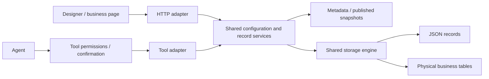

# Form Management Architecture and Design Notes

Last updated: 2026-10-26

Status: design plus current implementation notes. Form metadata and runtime
records are implemented under `/api/v1/forms`. Storage supports both dynamic
JSON records and form-managed physical tables through the shared form engine.

Scope: System Admin / Form Management

## 1. Positioning

Form Management is not only a visual form list. In this product it is the structural management entry for configurable business data objects.

The working definition is:

```text
Business form = metadata + published definition + runtime UI + business record storage
```

Form Management owns the data structure and field metadata. Form Designer owns layout, interaction, validation, linkage, and detailed user experience.

Current implementation note: forms and fields are persisted as metadata under
`/api/v1/forms`. Dynamic storage uses `dynamic_records.data`; physical storage
uses the shared form engine to provision and extend form-managed tables.

### Architecture flow



This is a service boundary inside the existing modular monolith. It does not
introduce independent microservices or fully remove remaining route-owned logic.

### Shared service boundary (2026-10-26)

HTTP endpoints and AI handlers share business services. Routes retain request
dependency injection and their existing response shapes. AI adapters translate
payloads and preserve their existing authorization and confirmation flow.

- `backend/app/services/form_schemas.py`: shared request models, also re-exported
  by `app.api.forms` for compatibility with existing callers.
- `form_definition.py`: canonical field normalization, serialization, designer
  settings, publication snapshots, and impact checks.
- `form_fields.py`: field creation, batch creation, updates, and archival.
  UI creation and AI creation/addition share name checks, type normalization,
  active field limits, and physical table provisioning. Batch input is fully
  validated before metadata or layouts change. AI addition retains its layout
  synchronization; ordinary UI addition retains its existing layout behavior.
- `form_versions.py`: publication preview, publishing, draft restoration, and
  version reads. AI business-form creation uses the same publication validation
  and permission synchronization as the designer. Composition can defer commit
  so form metadata, fields, layouts, and initial version commit together.
- `form_layouts.py`: layout reads, saves, and field insertion into layouts.
- `form_rule_preview.py`: runtime/designer evaluation and option previews.
- `records.py`: existing shared record reads/writes, authorization, and storage.

The `low_code.inspect_form` AI skill exposes five read tools:
`forms.preview_publish`, `forms.list_versions`, `forms.get_version`,
`forms.get_layouts`, and `forms.evaluate_rules`. These call the same services as
HTTP routes and require administrator/configuration access. Definitions are
included in both the repository registry seed and the packaged fallback assets.
Existing installations with a persisted AI registry must import the updated
registry seed through their normal registry administration flow to enable new
tool definitions; existing tools use the shared services immediately after the
code update.

New form logic should be implemented in the relevant service and called by
adapters. Do not copy business validation or physical DDL into an AI handler,
and import shared schemas/serializers from services rather than `app.api.forms`.
Compatibility exports are retained for older callers. This change covers the
field, version, layout, and rule-preview paths; application navigation,
action/permission CRUD, and workflow-start compatibility helpers still live in
the HTTP module.

Regression coverage: `backend/tests/test_form_shared_services.py` exercises
real SQLite databases for dynamic and physical storage, HTTP/AI parity, batch
validation, field limits, tenant boundaries, registry dispatch, and AI creation.
PostgreSQL row-lock concurrency remains covered by the existing optional
`RECORD_TEST_DATABASE_URL` test environment.

## 2. Boundary

### Form Management Owns

- Form basic information:
  - form name
  - form code
  - bound business object / ontology object
  - target data source and form-managed storage configuration
  - status
  - owner
  - description
- Field structure:
  - display name
  - field code
  - storage key / physical column mapping
  - data type
  - length / precision
  - allow null
  - unique
  - indexing intent (general per-field index automation is not implied)
  - default value
  - relation target, when the field is a relation
  - base component type
  - field description
- Field usage flags:
  - list display
  - form entry
  - searchable

### Form Designer Owns

- Required-state configuration and immediate UI feedback; backend enforcement remains authoritative
- Placeholder text
- Field width and layout
- Form sections and grouping
- Conditional visibility
- Field linkage
- Advanced validation rules
- Option source details
- Button layout
- Field-level interaction details
- Fine-grained field permission behavior

Important distinction:

```text
allow null = storage/schema intent
required = runtime input constraint, checked by the backend as well as the UI
```

Form Management may configure structural intent such as field code, data type,
and whether a value may be empty. The current runtime validation is enforced by
shared services before writing JSON or physical-table records. Managed drafts
can use partial validation; submission and other lifecycle operations enforce
their corresponding requirements.

## 3. Recommended Two-Column Layout (UX Design)

Form Management should stay as a two-column management page.

```text
+----------------------+--------------------------------------------+
| Form list            | Form basic information                     |
| narrow selector      | ------------------------------------------ |
| icon + name + summary| Field structure / database field metadata  |
+----------------------+--------------------------------------------+
```

### Left Column

The left column is only for selecting a form. Keep it narrow, roughly 260-300px.

Each item should use the same compact visual language as the application assembly list:

```text
[icon] Device Health Form
       Device / equipment
       8 fields    Published
```

The list should avoid heavy actions and detailed configuration. It should answer:

- What form is this?
- What business object or data source does it map to?
- How many fields does it have?
- What is its status?

### Right Column

The right column contains two stacked sections.

```text
Top: form basic information
Bottom: fields
```

The top section is the current form's identity and binding. The bottom section is the current form's data structure.

## 4. Field Table (UX Design)

The field table should prioritize metadata design and generated CRUD behavior.

Suggested columns:

```text
Field label
Field code
Storage key
Data type
Length / precision
Allow null
Unique
Indexed
Component
List
Form
Search
```

Example:

```text
Field label   Field code    Type      Length   Allow empty   Unique intent   Indexed intent   Component   List   Form   Search
Device name   name          string    100      No            No              Yes              Text        Yes    Yes    Yes
Device code   code          string    64       No            Yes             Yes              Text        Yes    Yes    Yes
Health score  health_score  decimal   5,2      Yes           No              No               Number      Yes    Yes    No
Status        status        enum      -        No            No              Yes              Select      Yes    Yes    Yes
```

## 5. Actions (UX Design)

Recommended actions for Form Management:

- Sync fields: import or refresh field definitions from an existing data source, ontology object, or supported physical table bindings.
- Add field: create a new metadata-backed field.
- Enter form designer: open the later design surface for layout, validation, linkage, and richer interaction rules.
- Save configuration: persist form basic information and field structure.

The action meanings:

```text
Sync fields        -> structural metadata import / refresh
Add field          -> field metadata creation
Enter form designer -> UI layout and interaction design
Save configuration -> persist structure metadata
```

## 6. Relationship With Application Assembly

Form Management creates and maintains reusable business forms.

Application Assembly decides which forms are available in an application and how they appear in that application's navigation.

```text
Form Management    -> defines the form and its data structure
Application Management -> defines the application identity and access surface
Application Assembly   -> binds forms to applications and organizes menu entries
Form Designer      -> configures form layout and interaction details
```

This keeps the mental model clean:

```text
Form Management = define configurable business objects
Form Designer = design how users work with those objects
Application Assembly = place those objects into applications
```

## 7. Lifecycle

See also: `docs/architecture/configuration-lifecycle.md`.

Current implementation:

- `form_versions.py` owns preview, publication, draft restoration, and version
  reads; `form_runtime.py` resolves the latest published field snapshot.
- Publication checks existing record compatibility and design errors, promotes
  configuration, synchronizes published permissions, and saves a new version.
- Draft restoration restores design configuration and saved defaults; it does
  not delete business records or recreate the entire schema.
- Physical form creation and field additions may execute DDL before publication.
  Archiving a field does not drop its physical column.
- AI business-form creation uses the same publication operation with deferred
  commit; analysis-form creation retains its draft path.

The following state/action model is **product design guidance**, not a guarantee
that every transition or deletion guard is implemented:

```text
draft -> published -> disabled -> archived
```

Recommended form actions:

Draft:

```text
Save draft
Publish
Delete draft
```

Published:

```text
Save low-risk metadata changes
Create change draft using the existing published version
Disable
Copy as new draft
```

Disabled:

```text
Enable
Archive
Save metadata
```

Form delete should be stricter than application delete:

```text
draft with no physical table and no app binding -> can delete
published -> cannot hard delete directly
has business records or physical table -> intended deletion restriction
used by application assembly -> cannot delete until unbound, or archive instead
```

For the current implementation, the rule is:

```text
Save design draft = persist draft configuration without publishing it
Publish = validate and save a runtime snapshot with published permissions
Add physical field = persist field metadata and provision its physical column
```

Physical table provisioning already exists. The current create/add-field paths
can perform DDL; do not describe every configuration write as metadata-only.
A future separate provisioning/review workflow would be a behavior change.

Product validation checklist (design guidance; current enforced checks live in
`form_definition.py` and its delegated validators):

- form name
- unique form code
- at least one field
- unique field codes
- valid and unique database column names
- supported field types
- valid form code and storage keys
- impact on existing records in either storage mode, when applicable

Before publishing a form, the UI should summarize metadata impact:

```text
Fields to add
Fields to modify
Fields to remove or hide
Required/empty-value behavior
Potential effect on existing dynamic records
```
