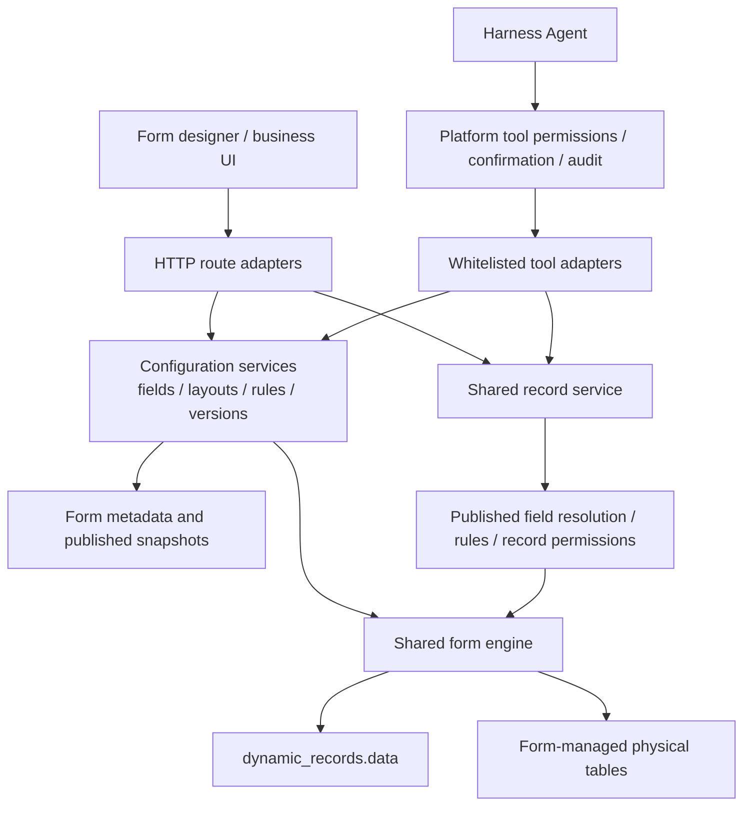

# Low-Code Platform Architecture

Last updated: 2026-10-26

Status: current local implementation plus explicitly labeled next steps. For
endpoint contracts, use [API Reference](../development/api-reference.md).
For the whole system, see [Architecture Overview](overview.md).

## 1. Architecture and Core Concepts

The platform is part of a modular FastAPI monolith. React pages and AI tools
converge on shared business services. Applications organize access and navigation;
forms define configurable business structures; records hold business data.

- **Application**: business workspace, identity, visibility, and menu structure.
- **Form**: fields, layouts, rules, actions, permissions, and storage configuration.
- **Application-form binding**: makes a reusable form available in an application.
- **Menu node**: organizes application entries and their visibility.
- **Form version**: published snapshot used by runtime field resolution.
- **Business record**: row stored as JSON/JSONB or in a form-managed physical table.
- **Workflow binding**: connects form events/actions to workflow definitions.
- **AI tool**: permissioned adapter to platform capability, with declared inputs,
  side effects, and an executable handler from the backend allowlist.

## 2. Shared Service Flow



Configuration services own definitions and publication. Runtime services own
record authorization, validation, encoding, data access, and lifecycle checks.
Frontends may preview behavior, but backend services enforce write constraints.

## 3. Current Module Ownership

- `services/form_schemas.py`: shared request models. Legacy imports through
  `api/forms.py` remain supported.
- `services/form_definition.py`: field normalization, serializers, designer
  settings, publication snapshots, and impact reports.
- `services/form_fields.py`: field/batch creation, updates, and archival. UI and
  AI field creation share type/name checks, active field limits, and physical
  schema extension. Full batch validation precedes metadata/layout changes.
- `services/form_versions.py`: publication preview, publishing, restoration of
  design drafts, and version reads. AI business-form initial publication uses
  this service with deferred commit, keeping creation in one outer transaction.
- `services/form_layouts.py`: layout reads/saves and field insertion into layouts.
- `services/form_rule_preview.py`: runtime/designer rules and option previews.
- `services/form_runtime.py`: published field resolution and record serialization.
- `services/records.py`: common business record boundary for HTTP, AI, dashboards,
  and workflow consumers, including tenant/row/field authorization.
- `api/form_engine/`: shared storage, naming, encoding, query, validation, and
  sequence helpers. This is still a legacy API namespace, not an independent
  domain package.
- `services/form_approval_config.py` and `form_application_lifecycle.py`: approval
  configuration and draft/submission lifecycle integration.
- `services/form_imports.py`, `form_files.py`, `form_option_sources.py`,
  `form_defaults.py`, `form_calculations.py`, and `form_rules.py`: existing reusable
  capabilities called by the configuration/runtime paths.

Ordinary UI field creation preserves its existing layout behavior. AI addition
opts into list/form layout insertion through the shared helper. The service
boundary unifies business constraints while keeping this orchestration explicit.

## 4. Persistence and Storage

Metadata is persisted in `forms`, `form_fields`, `form_layouts`, `form_actions`,
`form_permissions`, `form_versions`, `workflow_bindings`, `application_forms`,
and `application_menu_nodes`.

Record storage supports two paths:

- **Dynamic**: records live in `dynamic_records.data` as JSON/JSONB.
- **Physical**: a form-managed business table stores record columns and system
  metadata. Provisioning and column additions use the shared form engine.

The current HTTP creation path converts `storage_mode=dynamic` without a
`table_name` to generated physical storage. AI creation also provisions a
form-managed physical table. Do not interpret the schema model's default value
as a guarantee that a newly created form will use JSON storage.

Creating a physical form can run `CREATE TABLE`; adding fields can run
`ALTER TABLE`. Field archival is metadata archival rather than column deletion.
The platform already implements physical storage; it is not a future-only
feature. Table names are validated/scoped by the relevant creation path.

Relevant migrations include `0006_platform_forms.py`, `0021_form_versions.py`,
`0029_form_physical_tables.py`, and `0035_form_code_sequences.py`.

## 5. Configuration and Runtime Lifecycle

```text
Configure fields / layout / rules
  -> validate and save draft metadata
  -> preview publication impact and blocking errors
  -> publish snapshot and synchronize published permissions
  -> runtime resolves the latest published fields
  -> records are read/written through the shared service and selected adapter
```

Design draft saves do not automatically publish their layout/interaction changes.
Physical schema extension is a separate storage effect and may already occur
when adding a field. For an unversioned form, runtime fields fall back to metadata.

AI business-form creation composes fields, layouts, optional navigation bindings,
and initial publication. It calls the shared publication service instead of
constructing a separate unchecked published snapshot. Analysis-form creation
retains its distinct draft behavior.

Business record lifecycle is separate from definition publication. Draft saving,
submission, approval, rejection, and edit restrictions are governed by record
and workflow/lifecycle services. Publishing a form is not record submission.

## 6. AI Tool Entry Points

The existing record and configuration tools retain their adapters, including
record query/detail/update, draft creation, form creation, and field addition.
They reuse the shared services appropriate to their operation.

The `low_code.inspect_form` skill adds five read tools:

- `forms.preview_publish`: publication impact and blocking-error preview.
- `forms.list_versions`: published version list.
- `forms.get_version`: one published version snapshot.
- `forms.get_layouts`: stored layouts.
- `forms.evaluate_rules`: runtime rule results and field states without saving.

`services/ai/form_configuration_tools.py` validates payloads and calls the same
services as the HTTP routes. These tools require administrator/configuration
access. They do not add AI publication or layout-write tools.

Definitions exist in `data/agent_registry/{skills,tools}.json` and the packaged
fallback assets under `backend/app/services/ai/assets/`. Existing database-backed
registries require their normal explicit import/update flow; changing seed files
alone does not migrate an installed registry. Code availability and deployment
availability must be reported separately.

## 7. Runtime Permissions and Reads

The shared record boundary enforces tenant isolation, form actions, row scopes,
and field projection. Tool gating supplements these service checks. Record
filtering and metrics must operate on data the current actor can access.

Both storage adapters support existing pagination/search/filter paths. Cursor
pagination is available for scale-oriented reads. Some row-scoped queries still
authorize batched rows in application code; SQL policy pushdown and indexes for
hot fields remain scaling work. Physical storage alone does not prove
high-volume performance or remove permission checks.

## 8. Compatibility and Remaining Work

- The older `/api/v1/model-driven` surface coexists with the forms platform.
  Prefer shared forms services for new configurable application work.
- `api/forms.py` still owns application/menu, action/permission CRUD, and some
  workflow compatibility helpers. Not all handlers have been extracted.
- `FormSettings/index.tsx` remains large despite reusable controls and editors.
- Some services still import helpers from API namespaces. Continue removing
  reverse dependencies without breaking the legacy compatibility exports.
- Future changes should extend one business service and its adapters rather than
  copy checks into another endpoint, tool, or component.

## 9. Verification

`backend/tests/test_form_shared_services.py` covers HTTP/AI normalization parity,
whole-batch rejection, field limits, physical columns, tenant/admin boundaries,
layout insertion, registry dispatch, and AI creation using isolated SQLite
storage modes. Existing record tests cover broader cross-consumer contracts.
PostgreSQL row-lock concurrency needs the separate disposable
`RECORD_TEST_DATABASE_URL` environment; SQLite passing is not proof of those locks.

See [Form Management](form-management.md) for configuration/product boundaries
and [Platform Database](platform-database.md) for persistence details.
