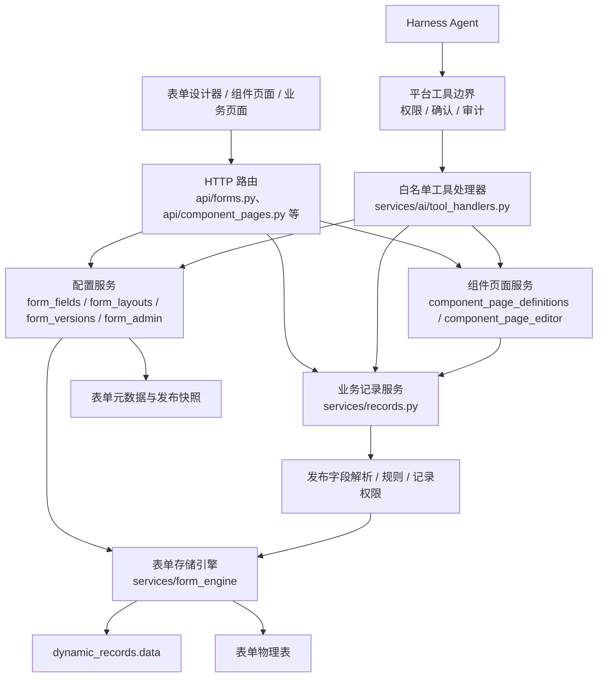

# 低代码平台架构

更新日期：2026-11-17（对应代码版本 0.3.22 草稿）

本文说明低代码平台在代码中的实现方式：页面和 AI 共用的业务服务、配置与运行的分离、表单存储引擎、业务记录边界、组件页面，以及 AI 工具如何接入这些服务。表单字段、版本、规则、权限与审批的细节见[表单管理](forms.md)，应用与菜单见[应用管理](applications.md)，完整接口清单见 [API 参考](../../development/api-reference.md)。

## 1. 核心概念

| 概念 | 落在哪里 | 说明 |
| --- | --- | --- |
| 应用 | `applications`、`application_roles` | 业务工作区的身份、可见角色与默认入口 |
| 应用菜单节点 | `application_menu_nodes` | 应用内的菜单树，节点可指向表单、组件页面或路由 |
| 应用与表单绑定 | `application_forms` | 让一个可复用的表单出现在某个应用中 |
| 表单 | `forms` 及 `form_fields`、`form_layouts`、`form_actions`、`form_permissions` | 字段、布局、规则、动作、权限与存储方式的设计期定义 |
| 表单版本 | `form_versions` | 发布时写入的不可变快照，运行期字段以最新快照为准 |
| 业务记录 | `dynamic_records.data` 或表单物理表 | 按表单存储方式保存的一行业务数据 |
| 流程绑定 | `workflow_bindings` | 把表单动作（通常是 `submit`）连到流程定义 |
| 组件页面 | `component_pages`、`component_page_versions` | 由列表、筛选、指标、图表等组件组成的页面，有独立的草稿与发布版本 |
| AI 工具 | 数据库中的技能与工具注册表 | 带权限、确认与审计的平台能力适配层，处理器来自后端白名单 |

## 2. 共享服务边界

页面接口和 AI 工具是同一组业务服务的两个入口。路由层只做参数解析、依赖注入和响应格式；AI 适配层只做载荷校验和确认流程；业务规则、权限过滤和存储访问都在服务层。



0.3.22 把表单存储引擎从 `api/forms.py` 移到 `services/form_engine/`，并把字段、版本、布局、规则预览、表单定义管理、动作、权限、流程绑定、菜单节点写入等逻辑迁入服务层。当前 `app/services`、`app/core`、`app/models` 中没有任何对 `app.api` 的导入，`backend/tests/test_layering.py` 会持续检查这一点。

`api/forms.py` 仍然保留以下逻辑，没有对应的独立服务函数：

- 新建表单（`POST /forms`），包括存储方式的选择和默认布局、默认动作的创建。
- 读取表单（`GET /forms/{id}`、`GET /forms/code/{code}`），包括按 `schema`（草稿或已发布）和 `scope`（`list`、`filters`、`create`、`edit`、`designer`）裁剪返回内容、生成运行期权限摘要；读取时还会为 AI 创建的旧式 JSON 表单补齐默认视图和布局。
- 应用与表单绑定的增删改查、应用菜单排序（`menu-order`）。
- 记录导出为 CSV、附件上传下载的字段校验、选项查询入口。
- 申请提交（`POST /forms/{id}/records/{record_id}/submit`）的编排。

`api/forms.py` 和 `api/component_pages.py` 会再导出服务层的函数和模型，以兼容旧的调用方和测试。新代码应直接从 `app.services` 导入。

表单相关服务的职责：

| 服务 | 职责 |
| --- | --- |
| `form_schemas` | 表单、字段、布局、动作、权限、流程绑定、记录写入的请求模型 |
| `form_definition` | 字段类型规范化、序列化、设计器配置应用到字段、发布快照、发布影响报告 |
| `form_fields` | 字段新增（单个与批量）、修改、归档；新增时同步扩展物理表 |
| `form_layouts` | 布局读取、保存，以及把新字段追加到列表和表单布局 |
| `form_versions` | 发布预检、发布、从已发布版本恢复草稿、版本读取 |
| `form_admin` | 表单复制、修改、删除，动作、权限、流程绑定的增删改查 |
| `form_runtime`、`form_published_payload` | 运行期字段解析（最新发布快照优先）、已发布表单载荷 |
| `form_rules`、`form_rule_preview` | 显示、必填、只读规则，关联选项，赋值与计算，规则预览 |
| `records` | UI、AI、看板、流程共用的记录读写边界 |
| `form_engine/` | 物理表命名与建表、记录校验、自动编码、查询辅助、编码流水号 |

## 3. 配置与运行的分离

设计期的修改保存在表单元数据和 `forms.config` 中；运行期页面读取最新发布快照。发布由 `form_versions.publish_form` 完成，流程如下：

```text
配置字段 / 布局 / 规则 / 权限
  -> 保存草稿（写 forms.config、form_fields、form_layouts）
  -> 发布预检：影响报告 + 设计错误，任何阻断项都会拒绝发布
  -> 发布：把设计器草稿提升为正式配置，同步角色权限，写入 form_versions 快照
  -> 运行期：form_runtime 用最新快照中的字段，records 按存储方式读写
```

并不是所有配置都进快照。下表区分哪些修改要发布后才生效、哪些立即生效：

| 配置 | 生效时机 |
| --- | --- |
| 字段的标签、必填、选项、控件类型、规则、默认值、计算公式等 | 发布后生效。运行期字段来自快照；没有任何发布版本的表单才直接使用 `form_fields` 草稿 |
| 列表视图 `viewConfig`、表单布局 `formLayout`、角色权限设计 `permissionDesign` | 发布后生效。设计器把草稿写入 `viewConfigDraft`、`permissionDesignDraft`，发布时提升为正式配置 |
| 物理表的新列 | 新增字段时立即执行 `ALTER TABLE`，不等发布 |
| 通过 `/forms/{id}/permissions` 直接维护的 `form_permissions` 行 | 立即生效，运行期权限判定直接读这张表 |
| 流程绑定（`workflow_bindings`）和表单审批设置 | 立即作用于之后的提交；快照中虽然记录了绑定，但启动流程时读取的是当前绑定 |
| 组件页面 | 有独立的草稿和发布版本，与表单发布互不影响 |

两个需要注意的例外：

- 已发布载荷（`form_published_payload`）中，如果快照的 `viewConfig` 没有列表列、或缺少筛选而当前配置有筛选，会回退使用当前的 `viewConfig`。这是为兼容早期快照，意味着这类表单的视图修改可能在发布前就出现在运行页。
- 表单设计器发布时（`FormSettings/index.tsx` 的 `confirmPublish`）先把列表视图写入 `viewConfigDraft`，再保存流程定义、更新流程元数据，最后调用发布接口。这几步不在同一个事务中：发布接口拒绝时，流程定义的修改已经生效，详见[表单](forms.md)。

业务记录的生命周期与表单发布是两回事。草稿保存、提交、审批、驳回和编辑限制由记录服务和 `form_application_lifecycle` 控制，发布表单不会提交任何记录。

## 4. 表单存储引擎

### 4.1 两种存储方式

`forms.storage_mode` 为 `physical_table` 或 `business_table`，并且 `forms.table_name` 有值时，表单使用物理表；否则使用 `dynamic_records.data`（JSON/JSONB）。判定函数是 `form_engine/naming.py` 的 `_uses_physical_form_table`。两种方式的对比见[数据模型](../data-model.md#3-表单的两种存储方式)。

模型默认值 `storage_mode="dynamic"` 不代表新表单会使用 JSON 存储。当前所有新建路径都会落到物理表：

- `POST /forms`：请求中 `storage_mode` 为 `dynamic` 且没有 `table_name` 时，改为 `physical_table` 并生成表名。
- 表单复制（`form_admin.copy_form`）：目标表单固定为 `physical_table`。
- AI 创建表单（`low_code_tools`）：固定为物理表，表名由服务端根据编码和当前租户生成，忽略 AI 载荷中的表名。

仍在使用 JSON 存储的是历史表单和种子表单。`scripts/materialize_business_forms.py` 可以把 JSON 存储的正式表单迁移到物理表。

### 4.2 命名规则

- 新表名形如 `t<租户ID>_business_<编码>`；分析类表单（`assemblyKind` 等于 `analysis`、`dashboard`、`report` 等）使用 `analysis_` 前缀。
- 已有表单保留 `forms.table_name` 中的原表名；不带租户前缀的 `business_*`、`analysis_*` 仍然有效，用于种子表单。
- 用户指定的表名必须匹配 `business_` 或 `analysis_` 命名空间，不能指向核心表，也不能使用其他租户的 `t<n>_` 前缀（`_validate_physical_table_name`）。
- 列名由字段名转换：驼峰转下划线，非字母数字替换为下划线；所有动态表名、列名都经过 `app/core/identifiers.py` 校验。

### 4.3 建表与加列

`form_engine/physical.py` 的 `_ensure_physical_form_table` 在建表、新增字段、读写记录前被调用：

- 系统列：`id`、`tenant_id`、`record_status`（默认 `active`）、`created_by`、`updated_by`、`source_dynamic_record_id`（迁移来源，唯一）、`deleted_at`、`created_at`、`updated_at`。
- 字段列类型：`integer` 为 `INTEGER`，`number`、`decimal`、`float` 为 `DOUBLE PRECISION`，`boolean` 为 `BOOLEAN`，`date` 为 `DATE`，`datetime` 为 `TIMESTAMP`，其他（含 `json`、`enum`、`relation`）为 `TEXT`。新增列都允许为空。
- 索引：每张表有 `(tenant_id, deleted_at, id)` 索引；启用的自动编码字段另建 `(tenant_id, 列)` 唯一索引。旧表已有重复编码时，唯一索引创建失败只记日志，不影响写入。字段的 `searchable`、`sortable` 标记不会建索引。
- 并发：PostgreSQL 上只有在缺列或缺索引时才取 `pg_advisory_xact_lock`，避免每次读写都加锁。
- 归档字段只改元数据，不删除物理列；删除草稿表单也不会删除物理表。

### 4.4 引擎模块

| 模块 | 内容 |
| --- | --- |
| `naming.py` | 表名、列名、租户命名空间、分析表单判定 |
| `validation.py` | 记录状态白名单、字段值校验、单条记录 2 MiB 上限 |
| `encoding.py` | 自动编码规则：模板、日期段、条件规则、重置周期 |
| `sequences.py` | 编码流水号：在 `form_code_sequences` 中用单条 `UPDATE ... RETURNING` 原子分配，首次分配时从已有记录推算起点 |
| `query.py` | 搜索、筛选、排序的 SQL 下推与内存匹配 |
| `physical.py` | 物理表 DDL、读写载荷转换、字段变更影响分析 |

## 5. 业务记录边界

`services/records.py` 是所有记录读写的唯一入口，HTTP 路由、AI 工具、看板、组件页面、流程审批和批量导入都调用它。

写入时依次执行：

1. 租户和表单级权限（`create`、`edit`、`delete`）。
2. 行级权限：角色权限的数据范围和行条件，以及设计器角色配置中的数据范围（见[表单管理](forms.md#7-权限)）。
3. 字段级权限：无权字段、未知字段、已归档字段的写入直接拒绝。
4. 业务数据不能覆盖保留元数据（`id`、`tenant_id`、`record_status`、`created_by` 等）。
5. 表单规则：默认值、关联校验与回填、赋值、计算、显示与必填、只读、控件校验、附件校验。
6. 自动编码、唯一规则、租户记录数配额（物理表与 JSON 记录共用 `dynamicRecords` 配额）。
7. 写入 JSON 记录或物理表，写审计日志。

更新时支持 `expected_values` 乐观校验：传入的原值与当前记录不一致时返回 409；脱敏字段不能作为比较依据。处于审批中的记录由 `form_workflow_start._protect_pending_form_record` 保护。删除是软删除（写 `deleted_at`）。

读取时，记录先按行级权限过滤，再按字段权限、脱敏规则和当前审批节点的字段可见性投影，最后附加申请生命周期信息（`_approval`）。

列表查询有两条路径：

- 管理员、表单没有脱敏或复制规则、不是告警中心时，JSON 存储表单把搜索、筛选、排序和分页下推到 SQL；物理表走 `_list_physical_records`。
- 其他情况由 `iter_raw` 按每批 200 行扫描全部记录，先鉴权和投影，再在内存中搜索、筛选、排序和分页。这保证隐藏值不会影响搜索结果和计数，但数据量大时较慢。

生产模式下，关键词搜索要求至少有一个可见的 `searchable` 字段，按字段筛选要求该字段是 `searchable` 或 `sortable`。游标分页（`cursor_after_id`、`cursor_before_id`）在 JSON 存储的 SQL 路径上要求搜索和筛选都能下推；物理表的游标分页走内存路径。

## 6. 组件页面

组件页面让配置人员在一个画布上组合多个组件，每个组件可以绑定不同的来源表单。定义的模型在 `services/component_page_definitions.py`，保存、发布和运行期数据在 `services/component_page_editor.py`，路由在 `api/component_pages.py`（前缀 `/api/v1/pages`）。

### 6.1 定义结构

页面定义 `PageDefinition` 以 JSON 保存在 `component_pages.draft` 和 `component_page_versions.definition` 中，没有为组件单独建表：

- 页面级：`title`、`schemaVersion`（1 或 2，旧快照仍可读取）、默认来源 `sourceFormId`、全局筛选字段 `filterFields`（最多 12 个，只作用于默认来源）、页面角色 `roleIds`、最多 30 个组件 `widgets`、页面样式 `style`（含刷新间隔 `refreshInterval`，0 到 86400 秒）。
- 组件类型：`record-list`（业务列表）、`record-filter`（筛选）、`metric`（指标）、`chart`（图表，柱、线、饼、排行表）、`workspace`（我的工作台模块）。
- 组件可以用 `dataBinding.formId` 指定来源；没有指定时继承页面的 `sourceFormId`。
- 统计组件支持聚合（`count`、`sum`、`avg`、`min`、`max`）、`expression` 公式和共享指标引用（`sharedMetricId`、`sharedMetricVersion`）。
- 列表组件的 `listSettings` 配置显示列、排序、分页、行点击、工具栏与行操作；`filterSettings` 配置筛选方案、查询与重置按钮。

### 6.2 与表单的绑定

- 表单的 `config.componentPageEnabled` 和 `config.componentPageCode` 记录它绑定的页面。`POST /pages/forms/{form_id}/binding` 由管理员调用，幂等：已绑定时直接返回原页面；`blank=true` 创建空白页面，`populate=true` 且表单已发布或有看板设计时，由 `page_content_migration` 把原有列表、筛选、指标、图表转换为组件草稿。
- 第一次绑定时写入 `componentPageLegacyFallback`。页面发布之前，普通用户访问原路由仍进入旧的记录页或程序页；发布之后进入组件页面。
- 前端 `FormPageEntry`（`/dynamic/:slug`、`/program/:programId`）先请求 `GET /pages/forms/{slug}/binding`。管理员访问一个还没有页面的表单时，前端会自动以 `blank=true, populate=true` 创建绑定。地址带 `?view=records` 时直接显示记录页。
- `/studio/page-design` 是页面设计工作区，列出全部页面并可新建独立页面；`/pages` 和 `/pages/new` 重定向到这里，`/pages/:code` 打开具体页面。
- 独立的 `/form-settings/:formId` 默认重定向到 `/program/<编码>`；表单设计器主要以嵌入方式出现在组件页面的“录入”和“流程”页签中，地址带 `legacy=1` 或 `source=business-data` 时仍以独立页面打开。
- 批量补齐脚本 `backend/scripts/populate_component_pages.py` 默认只预演，加 `--apply` 才写入，只处理尚不存在的页面或 `revision=1`、未发布且没有组件的空页面；`--upgrade` 只升级旧转换程序生成且未修改、未发布的看板草稿。转换遇到范围条件、未知组件类型或非业务表单来源时报错，不会静默丢弃。

### 6.3 保存与发布

- 保存草稿（`PUT /pages/{code}/draft`）只校验来源表单属于当前租户，允许组件暂未绑定来源，允许空页面。
- 发布（`POST /pages/{code}/publish`）执行完整校验：每个组件都必须有来源；来源表单必须已发布；引用的字段必须存在于来源的发布字段中且未归档；列表显示列必须属于来源发布视图；统计公式必须能解析；联动目标必须存在且与源组件来源相同；角色、用户、组织都必须属于当前租户。
- 草稿和发布都用 `expectedRevision` 做并发检查，修订号不一致返回 409。发布会写入新的 `component_page_versions`。
- 组件页签发布（`POST /pages/{code}/widgets/{widget_id}/{section}/publish`）只把某个组件的“基本”或“数据”部分合并进当前线上版本，并生成新的页面版本；页面必须已有首个发布版本，新增组件必须通过整页发布。
- 页面版本列表和单个版本只读接口供“页面版本管理”使用；恢复版本由前端把旧定义放回草稿，仍走普通的保存与发布。恢复页面不会影响业务记录和来源表单、流程。

### 6.4 运行期数据与权限

- 页面入口由 `roleIds` 控制；绑定了宿主表单的页面还要求用户对宿主表单有查看权限且宿主表单已发布（管理员除外）。
- 组件可见性由 `accessGroups`（角色、用户、组织任一匹配）或旧的 `roleIds` 控制。服务端返回给普通用户的定义中会删去不可见组件，并清理指向它们的联动目标；管理员可以看到全部组件。
- 列表工具栏按钮组、显示列组、筛选方案和筛选字段组都按“角色、用户、组织”匹配，多个匹配组取并集；没有可用显示列或筛选方案时组件不显示。业务列表内嵌筛选的查询与重置按钮不按适用对象裁剪，取所有组配置按钮的并集。
- 这些都只是界面层的收窄。来源表单的行范围、字段读写、统计权限仍由记录服务判定，直接调用记录接口时同样生效。
- `POST /pages/{code}/data` 按来源分组读取数据。前端提交 `filter_queries`（按筛选组件 ID）和 `chart_values`（按图表 ID），服务端根据已发布定义推导目标组件，不接受任意组件 ID；多个条件取交集。必填筛选未填写时，目标列表和统计不出数据。混合来源页面中某个来源无权访问时，只有该来源的组件报错。
- 筛选与按钮权限模板保存在 `system_settings`（键 `permission-template:<租户>:<ID>`），按 `toolbar`、`access`、`display`、`filter`、`filter-fields`、`audience` 区分使用范围。
- “我的工作台”是代码为 `system-workspace-home` 的特殊页面，由管理员首次初始化时创建并直接发布。

当前不支持跨来源的字段映射联动，也不支持列表选中行向其他组件广播。

## 7. AI 工具入口

AI 通过 Harness 运行时调用平台工具，权限、确认和审计的通用机制见 [AI 能力总览](../ai/README.md)和 [AI Agent 技能与工具契约](../ai/skill-contract.md)。与低代码平台相关的部分：

- `services/ai/form_configuration_tools.py` 用显式白名单把工具映射到服务函数，模型不能指定任意函数。所有调用都要求管理员。
  - 只读检查：`forms.preview_publish`、`forms.list_versions`、`forms.get_version`、`forms.get_layouts`、`forms.evaluate_rules`，组成技能 `low_code.inspect_form`。
  - 设计写入：`forms.update_field`、`forms.archive_field`、`forms.save_layout`、`forms.publish`、`forms.restore_draft`、`forms.update_definition`、`forms.copy`、`forms.delete`，以及动作、权限、流程绑定的 `list`、`create`、`update`、`delete`。写操作沿用平台的确认卡片。
- `services/ai/low_code_tools.py` 的 `forms.create_form_definition` 在一个事务中创建表单、批量字段（调用 `form_fields.add_form_fields`）、布局、可选的应用绑定和菜单，并对业务表单调用 `form_versions.publish_form(defer_commit=True)` 完成首次发布；分析表单保持草稿。
- 记录类工具（查询、详情、更新、新建草稿）调用 `services/records.py`。
- 组件页面工具（`pages.*`）与页面联动工具 `ui.component_page.*`、表单设计器联动工具 `ui.form_designer` 分别见 `component_page_tools.py`、`component_page_controls.py`、`page_controls.py`。页面联动工具只修改当前浏览器中的未保存草稿，由用户最终保存或发布。

工具定义在 `data/agent_registry/tools.json` 和 `skills.json`，打包副本在 `backend/app/services/ai/assets/`。已有数据库的注册表不会因种子文件变化而更新，表单设计写入工具需要运行 `scripts/register_form_design_tools.py` 补齐（保留已有定义和停用状态）。代码中具备某个工具，不等于某个部署已经启用它。

## 8. 已知限制

- 非管理员的记录列表在内存中鉴权和分页，大数据量下需要把权限条件下推到 SQL 并为常用字段建索引。物理表存储本身不代表已经解决大数据量性能问题。
- `api/forms.py` 仍有第 2 节列出的路由内逻辑；`frontend/src/pages/FormSettings/index.tsx` 约 3700 行，仍是体量最大的前端文件。
- 旧版 `/api/v1/model-driven/*` 元模型接口与表单平台并存，新的可配置应用应使用表单平台服务。
- 新的业务约束应加在一个服务里，再由各个入口调用，不要在另一个路由、AI 处理器或 React 组件里复制校验。

## 9. 测试

- `backend/tests/test_form_shared_services.py` 用真实 SQLite 数据库覆盖两种存储方式下 HTTP 与 AI 的字段规范化一致性、整批拒绝、字段数量上限、物理列、租户与管理员边界、布局插入、注册表分发和 AI 创建。
- `test_record_service.py`、`test_forms_platform.py`、`test_form_lifecycle_integration.py`、`test_component_pages.py`、`test_page_content_migration.py` 等覆盖记录边界、表单平台、申请生命周期和组件页面。
- PostgreSQL 行锁并发测试需要单独的一次性数据库，通过 `RECORD_TEST_DATABASE_URL` 指定；SQLite 通过不能证明这些锁有效。测试运行方式见[测试说明](../../operations/testing.md)。
