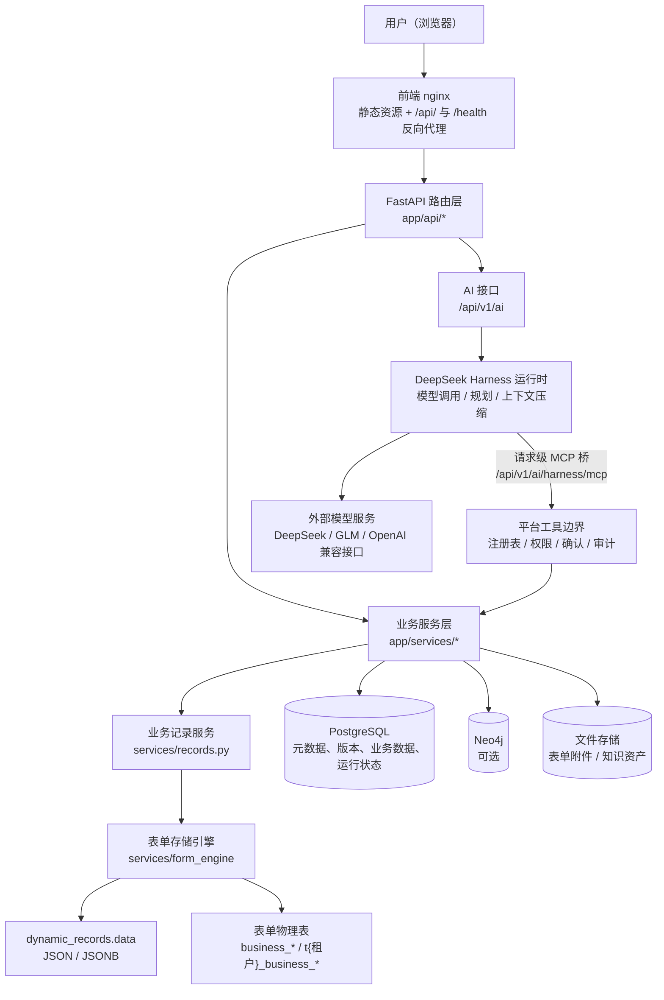
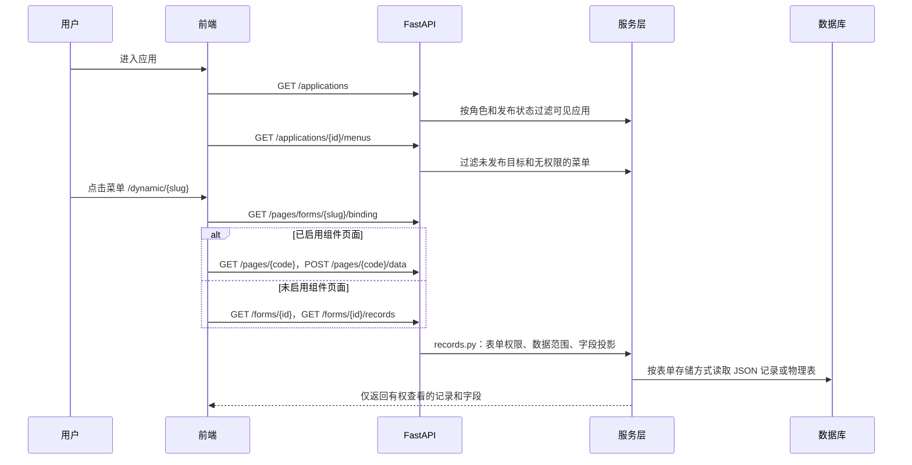

# 系统架构总览

更新日期：2026-11-17（对应代码版本 0.3.22 草稿）

本文描述代码当前已经实现的架构。各模块的详细现状在 `docs/architecture/` 的子目录中；借鉴 Palantir 的产品方向等设计与规划放在 `docs/design/`，不代表已实现。
需要按目录查找代码时，请看[代码框架](current-framework.md)。

## 1. 产品定位

ManuFoundry 是面向制造业的低代码数据工作区原型，目前用于演示和产品探索，不建议直接用于商业生产。主要能力：

- 业务人员在“业务工作台”中进入应用，查询和录入业务数据，处理审批待办。
- 配置人员在“应用配置”中搭建应用菜单、业务表单（字段、布局、规则、权限、审批）和组件页面（列表、筛选、指标、图表）。
- 数据人员在“数据中心”中接入外部数据库，管理数据资产、对象关系和知识库。
- 管理员在“后台设置”中管理组织、身份、权限、AI 服务和审计日志。
- AI 助手可以回答问题、读取业务数据，并在用户确认后代为执行配置或业务写入。

工程形态是**模块化单体**：一个 React 单页应用加一个 FastAPI 后端，所有业务模块在同一进程内共享数据库。页面接口和 AI 工具是同一组业务服务的两个入口，没有拆分独立部署的微服务。

## 2. 技术栈

| 层 | 技术（版本以 `package.json`、`requirements.txt` 为准） |
| --- | --- |
| 前端 | React 18、TypeScript 5.7、Vite 6、React Router 7、Ant Design 5、Ant Design Pro Components、Zustand、axios |
| 可视化 | ECharts、Cytoscape（含 dagre 布局）、React Flow |
| 后端 | Python 3.11、FastAPI 0.115、Uvicorn 0.34、Pydantic 2、pydantic-settings |
| 数据访问 | SQLAlchemy 2（异步）、Alembic、asyncpg、psycopg2、aiosqlite |
| 关系数据库 | PostgreSQL 16（Compose 与生产）；SQLite 仅在显式设置 `DATABASE_BACKEND=sqlite` 时用于本地和测试 |
| 图数据库 | Neo4j 5 Community（可选，不可用时图谱功能降级） |
| 分析与文档处理 | pandas、numpy、scipy、scikit-learn、openpyxl、pypdf、PyMuPDF、RapidOCR（onnxruntime） |
| AI 运行时 | `deepseek-harness-sdk` 与 `deepseek-harness-runtime-bin`，固定为 0.2.1rc2 |
| 鉴权 | python-jose（JWT）、passlib + bcrypt |
| 部署 | Docker Compose；前端镜像为 nginx 静态站点并反向代理 `/api/` |

`requirements.txt` 中 Prophet、Celery、LangChain 仍是注释状态，没有接入。0.3.22 已移除未使用的 Redis。

## 3. 系统上下文



系统没有缓存服务和消息队列。后端启动时在进程内启动两个后台循环（见 `backend/app/main.py` 的 `lifespan`）：

- AI 记忆过期清理任务，每小时一次；`memory.purge_expired` 目前为空操作，实际不删除条目。
- 流程自动下发处理器，每 5 秒用 `FOR UPDATE SKIP LOCKED` 领取最多 20 个待下发的流程实例，把字段映射发送到站内表单、API 或 Webhook。

## 4. 前端

前端是需要登录的单页应用，入口在 `frontend/src/App.tsx`。未登录时只能访问 `/login`。
导航分为五个区域（`frontend/src/config/navigation.ts`）：

| 区域 | 入口 | 内容 |
| --- | --- | --- |
| 业务工作台 | `/`、`/workflow`、`/scheduler`，以及各应用菜单指向的页面 | 我的工作台、流程与待办、日常任务、应用内业务页面 |
| 应用配置 | `/studio/*` | 应用与菜单、业务数据（表单）、页面设计、模板中心 |
| 数据中心 | `/data-center/*` | 数据接入、数据资产、基础数据、对象与关系、知识库 |
| 后台设置 | `/admin/*`（仅管理员） | 组织身份与权限、AI 与平台设置、审计日志，以及分析追溯和配置迁移等高级工具 |
| 插件与扩展 | `/plugins` | 扩展入口 |

应用菜单里的业务页面通过 `/dynamic/:slug` 或 `/program/:programId` 打开。页面入口会先请求 `GET /api/v1/pages/forms/{slug}/binding`：如果该表单已经启用组件页面，就渲染已发布的组件页面；否则回退到旧的动态记录页或程序页。
右下角的 AI 助手浮窗在整个工作区内可用。详细说明见[前端开发指南](../development/frontend.md)。

## 5. 后端分层

```text
app/main.py        创建应用、中间件、系统接口，在 /api/v1 下挂载全部路由
app/api/           HTTP 适配层：参数解析、依赖注入（鉴权、数据库会话）、响应格式
app/services/      业务服务：表单、记录、流程、页面、分析、知识、AI 等
app/core/          横切能力：数据库会话、JWT、权限判定、身份上下文、审计、日志、标识符校验
app/models/        SQLAlchemy 模型（relational.py）与 Neo4j 标签和关系类型（graph_models.py）
```

依赖方向固定为 `api → services → core/models`。`core`、`models`、`services` 不得导入 `app.api`，由 `backend/tests/test_layering.py` 强制检查。部分路由模块为兼容旧调用方会再导出服务层的函数，新代码应直接调用服务层。

鉴权分三层：

1. 路由依赖：除公开接口外，所有接口都依赖 `get_current_user`，由 `backend/tests/test_route_auth_coverage.py` 保证；管理接口再叠加 `require_admin` 或 `require_platform_admin`。
2. 服务层：业务记录读写按表单权限、数据范围、行条件和字段规则过滤；流程审批校验当前节点的审批人；发布与配置写入再次校验管理员身份。
3. 租户隔离：业务表都带 `tenant_id`，服务层查询按当前用户的租户过滤；平台级操作只允许租户 1 的管理员。

## 6. 关键运行流程

### 6.1 打开应用中的业务页面



### 6.2 表单的配置与发布

表单的配置和运行是分开的：

- 设计期：字段、布局、规则、权限、审批设置保存在 `forms`、`form_fields`、`form_layouts`、`form_permissions` 等表和 `forms.config` 中，可随时修改草稿。
- 发布：`POST /forms/{form_id}/publish` 先做影响检查和规则校验，再在 `form_versions` 中写入不可变快照。
- 运行期：`services/form_runtime.py` 优先使用最新发布快照中的字段；没有发布版本的表单才使用草稿元数据。保存草稿不会改变运行中的页面。

组件页面（`component_pages`）有独立的草稿、发布和版本历史（`component_page_versions`），与表单发布互不影响；页面中的组件仍按来源表单的权限读取数据。

### 6.3 AI 执行写操作

1. 前端调用流式接口 `POST /ai/agent/stream`，后端创建 Agent 运行记录（`ai_agent_runs`）并启动 Harness 运行时。`POST /ai/agent-runs` 是不写数据库的旧接口。
2. 运行时通过请求级 MCP 桥调用平台工具。工具清单来自数据库中按租户管理的技能和工具注册表。
3. 工具调用先校验当前用户权限、工具是否启用和参数。读工具经 `services/ai/tool_envelope.py` 直接执行；写工具在调用时只登记为待确认动作，生成确认卡片。全局执行模式 `agentMode` 默认为 `draft`，此时除记录草稿和画布工具外的写工具都不可用，需要管理员在 AI 设置中改为 `confirm`。
4. 用户在前端确认后调用 `POST /ai/agent-runs/{run_id}/confirm`（或其流式版本），后端用条件更新把运行状态从 `waiting_confirmation` 抢占为执行中以防重复执行，再调用与页面相同的业务服务完成写入并记录审计。详见 [AI 概览](ai/README.md)和[技能与工具契约](ai/skill-contract.md)。

AI 工具只是业务服务的薄适配层，不另写一套业务校验。

## 7. 数据与存储

| 存储 | 内容 |
| --- | --- |
| 关系数据库 | 99 张 ORM 表：制造业主数据、低代码平台元数据、业务记录、流程、身份与租户、知识库、AI 运行记录等，详见[数据模型](data-model.md) |
| 表单物理表 | 使用物理存储的表单在发布前由存储引擎建表或加列，表名形如 `business_<编码>`，新建表单带租户前缀 `t<租户ID>_business_<编码>` |
| Neo4j | 由种子数据或同步接口构建的制造业对象图（工厂、产线、设备、物料、订单、缺陷等），用于图谱探索、影响分析和追溯 |
| 文件 | 表单附件写入 `FORM_FILE_STORAGE_DIR`（默认 `/data/form_files`，生产使用 `form_files` 卷）；知识资产写入 `KNOWLEDGE_STORAGE_DIR` |

数据库结构变更只通过 Alembic 迁移完成（当前最新为 `0044_component_page_ai_tools`）。SQLite 模式由 `app/database.py` 的 `init_db()` 直接建表并补齐旧库缺失的列。

## 8. 运行模式

| 配置 | 演示模式 `APP_MODE=demo` | 生产模式 `APP_MODE=production` |
| --- | --- | --- |
| 数据库 | PostgreSQL，或显式选择 SQLite | 只能用 PostgreSQL，选择 SQLite 会启动失败 |
| `SECRET_KEY` | 可使用默认值 | 必须是 32 位以上的非默认值，否则启动失败 |
| `CORS_ORIGINS` | 可包含 `*` | 必须是明确的来源 |
| `SMTP_HOST` | 可为空 | 必填 |
| `DEMO_AUTH_OPTIONAL` | 不影响鉴权，所有受保护接口都要求令牌 | 必须为 `false`，否则启动失败 |
| 接口文档 | 开放 `/docs`、`/redoc` | 关闭 |

`GET /api/v1/system/readiness` 会汇总数据库、迁移版本、SMTP、存储目录和上述生产配置的检查结果。

## 9. 部署形态

| 场景 | Compose 文件 | 说明 |
| --- | --- | --- |
| 本地开发 | `docker/docker-compose.yml` | 后端热重载、Vite 热更新、源码挂载；所有端口对外开放 |
| 演示服务器 | 再叠加 `docker/docker-compose.prod.yml` | 生产镜像；前端 `80:80`；后端、PostgreSQL、Neo4j 只绑定 `127.0.0.1` |
| 私有化部署 | `docker/docker-compose.release.yml` | 拉取预构建镜像，不在部署机上构建 |
| 外部数据源演示 | `docker/docker-compose.external-sources.yml` | 6 个独立的 PostgreSQL，模拟 MES、ERP、QMS、WMS、SCM、CRM |

详见[部署说明](../operations/deployment.md)和[私有化部署](../operations/private-deployment.md)。

## 10. 当前边界

已实现但有限制：

- 知识检索没有语义能力：已入库文档按文本 SHA-256 摘要生成的 16 维伪向量计算余弦分，再加上英文词面匹配分；中文查询的词面分为 0，排序基本随机。没有接入向量数据库和外部向量模型。详见[知识库](knowledge/knowledge-base.md)。
- 带行条件的记录查询按每批 200 行扫描并在分页前鉴权，大数据量下还需要把权限条件下推到 SQL。
- 后台任务运行在 Web 进程内，没有独立的任务队列。
- 新增的 AI 工具定义写在种子文件中，已有数据库的注册表需要运行对应的注册脚本才会生效（见 `scripts/register_*`、`backend/scripts/upgrade_*`）。
- 旧版 `/model-driven/*` 元模型接口与新的表单平台并存。

尚未实现：

- 时序数据库（`sensor_readings` 是普通关系表）。
- Prometheus、Grafana 等监控体系（`/api/v1/system/metrics` 只是进程内计数）。
- Kubernetes 部署、自动持续部署（仓库中只有持续集成 `.github/workflows/ci.yml`）。
- 浏览器端到端测试。

## 11. 与 Palantir 概念的对应

| 概念 | 本项目中的实现 |
| --- | --- |
| Ontology（本体） | 语义资产与本体对象、关系、映射（`/semantic-assets`），Neo4j 对象图，制造业数据模型 |
| Workshop（业务应用） | 应用、应用菜单、组件页面、业务表单 |
| 数据集成 | 数据源接入、元数据扫描、同步任务、数据管道 |
| Actions（对象操作） | 表单动作、规则触发器、流程绑定与自动下发、通知 |
| AIP（AI 辅助） | Harness 运行时、平台工具边界、确认卡片、知识检索 |

参考设计见 [Palantir 平台关系图](../design/palantir/relationship-map.md)等文档。
