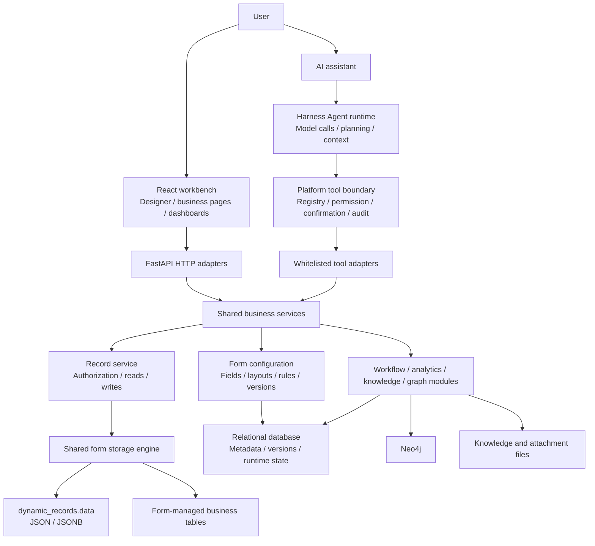
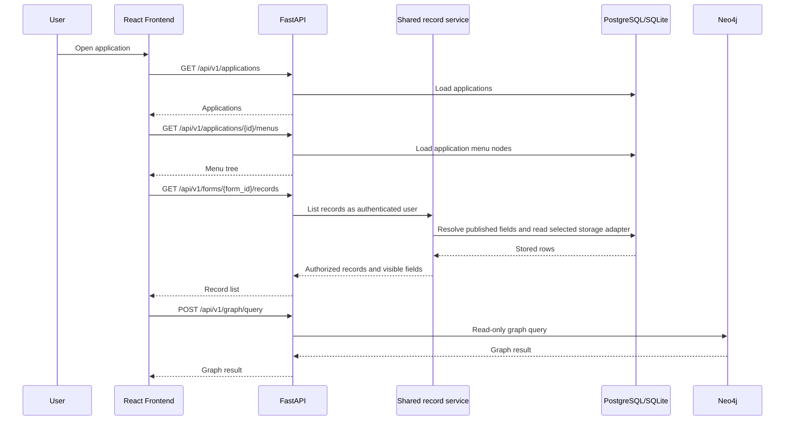

# ManuFoundry Architecture Overview

Last updated: 2026-10-26

This is the current high-level architecture document. It describes what the codebase implements now, and it separates that from Palantir-inspired reference direction.

## 1. Product Positioning

ManuFoundry is a manufacturing low-code analytics workbench. It borrows three important Palantir-style ideas and adapts them to manufacturing:

- **Ontology-first**: business objects such as equipment, work orders, inspections, suppliers, and materials should be understood through a shared semantic model.
- **Operational applications**: users work in role-oriented applications instead of raw tables or disconnected dashboards.
- **Data-to-action loop**: data, graph context, rules, workflows, notifications, and AI assistance should help users move from insight to action.

This project is a prototype, not a full Palantir clone. The current system implements a usable workbench shell, manufacturing APIs, SaaS tenant foundations, low-code form metadata/version persistence, workflow/rules/reporting modules, AI-assisted low-code planning, and several Palantir-inspired design documents.

The current implementation is a **modular monolith**: one React frontend and
one FastAPI backend, with business modules sharing database infrastructure.
Frontend pages and AI tools are separate entry points into shared business
services. The recent form refactor strengthens this boundary; it does not
introduce separately deployed microservices.

## 2. Current Technology Stack

| Layer | Current stack |
| --- | --- |
| Frontend | React 18, TypeScript 5.7, Vite 6, Ant Design 5, Ant Design Pro Components, Zustand |
| Visualization | ECharts, Cytoscape.js, cytoscape-dagre, ReactFlow |
| Backend | FastAPI 0.115, Uvicorn 0.34, Python 3.11, Pydantic 2, SQLAlchemy 2, Alembic |
| Relational database | PostgreSQL 16 in Docker; SQLite fallback for local/demo bootstrap |
| Graph database | Neo4j 5 community |
| Supporting infrastructure | Redis 7 is included in Compose; inclusion does not imply a separate worker service |
| Analytics libraries | pandas, numpy, scipy, scikit-learn |
| AI execution | Official DeepSeek Harness SDK/runtime; platform-owned MCP bridge, tool registry, permissions, confirmations, and audit |
| Optional libraries | Prophet, Celery, LangChain remain commented dependencies rather than the active Agent runtime |
| Deployment | Docker Compose development stack plus production overlay |

## 3. System Context



The diagram describes the service direction for the refactored form paths.
Some legacy route-owned helpers remain; see the current boundaries below.
PostgreSQL is the Compose relational database; SQLite is an explicitly selected
local/test alternative, not a second production database. Redis is supporting
Compose infrastructure and is not the source of form definitions or records.

## 4. Frontend Architecture

The frontend is a protected React single-page application.

Main responsibilities:

- Login and token restoration through `frontend/src/stores/authStore.ts`.
- Global shell in `frontend/src/App.tsx`.
- Workspace home route at `/`.
- Top application switcher.
- Application-specific side menu.
- Dynamic business pages under `/program/:programId`.
- Model/form-driven pages under `/dynamic/:slug`.
- System administration under `/system-admin`.
- Floating AI chat widget using `/api/v1/ai`.
- Centralized API client in `frontend/src/services/api.ts`.

Important frontend routes:

| Route | Purpose |
| --- | --- |
| `/login` | Login page |
| `/` | Workspace home |
| `/dashboard` | Production overview |
| `/maintenance` | Predictive maintenance |
| `/quality` | Quality analysis |
| `/supply-chain` | Supply chain risk |
| `/data-sources` | Data source management |
| `/ontology` | Ontology page |
| `/graph` | Graph explorer |
| `/pipeline` | Pipeline page |
| `/reports` | Report center |
| `/workflow` | Workflow center |
| `/templates` | Template marketplace |
| `/rules` | Rule engine |
| `/system-admin` | System administration |
| `/program/:programId` | Application program page |
| `/dynamic/:slug` | Dynamic model/form page |

## 5. Backend Architecture

The backend is a FastAPI application mounted around `/api/v1`.

System endpoints:

- `GET /`
- `GET /health`
- `GET /api/v1/system/readiness`
- `GET /api/v1/system/metrics`
- `GET /api/v1/release/current`

Main API modules:

| Area | Prefix |
| --- | --- |
| Auth | `/api/v1/auth` |
| Admin | `/api/v1/admin` |
| Applications | `/api/v1/applications` |
| Forms platform | `/api/v1/forms` |
| Workflow | `/api/v1/workflow` |
| Data sources | `/api/v1/data-sources` |
| Ontology | `/api/v1/ontology` |
| Graph | `/api/v1/graph` |
| Pipelines | `/api/v1/pipelines` |
| Semantic assets | `/api/v1/semantic-assets` |
| Knowledge base | `/api/v1/knowledge` |
| Analytics | `/api/v1/analytics` |
| Maintenance | `/api/v1/maintenance` |
| Quality | `/api/v1/quality` |
| Supply chain | `/api/v1/supply-chain` |
| AI assistant | `/api/v1/ai` |
| Dashboard | `/api/v1/dashboard` |
| Reports | `/api/v1/reports` |
| Model-driven | `/api/v1/model-driven` |
| Rules | `/api/v1/rules` |
| Notifications | `/api/v1/notifications` |
| Templates | `/api/v1/templates` |
| Config import/export | `/api/v1/config` |
| Scheduler | `/api/v1/scheduler` |
| Search | `/api/v1/search` |
| AI builder | `/api/v1/ai-builder` |
| Productization | `/api/v1/productization` |
| Platform tenant operations | `/api/v1/platform` |
| Current tenant profile | `/api/v1/tenant` |
| Release metadata | `/api/v1/release` |

## 6. Data And Persistence

The persistence layer has four main groups:

1. **Core manufacturing data**
   - Factories, workshops, production lines, equipment, sensors, work orders, inspections, defects, suppliers, materials, customers, and related seed data.
   - Modeled through SQLAlchemy models and seed JSON files.

2. **Low-code platform metadata**
   - Applications, application menus, roles.
   - Forms platform tables introduced by migration `0006_platform_forms.py`, versioned by `0021_form_versions.py`, seeded into production-like application assemblies by `0024_seed_application_assembly.py`, and extended with menu-node config by `0026_menu_node_config.py`.
   - Records support dynamic JSON/JSONB storage and form-managed physical tables.
     Migration `0029_form_physical_tables.py` supports physical storage; both
     adapters use the shared record boundary and published field resolution.

3. **SaaS tenant and identity operations**
   - Tenants, tenant domains, invites, redacted exports, password reset tokens, sessions, password history, and OIDC state rows.
   - Tenant isolation is progressively applied across low-code, workflow, reports, notifications, rules, scheduler, knowledge, and AI runtime rows.

4. **Knowledge and AI runtime observability**
   - Knowledge documents, chunks, ingestion jobs, extraction jobs, and object links have relational persistence for the current MVP.
   - Knowledge Agent conversations, messages, runs, tool calls, and memory rows
     are stored in the relational database through migration
     `0015_ai_agent_runtime.py`.
   - General `/api/v1/ai` conversations and memory APIs now have persisted runtime surfaces, while low-code writes remain admin-only and confirmation-gated.

Forms platform tables:

| Table | Purpose |
| --- | --- |
| `forms` | Form/business object definition |
| `form_versions` | Immutable published form snapshots |
| `application_forms` | Application-form binding |
| `application_menu_nodes` | Application-specific menu tree |
| `form_fields` | Field metadata |
| `form_layouts` | List/detail/edit layout metadata |
| `form_actions` | Configurable action buttons |
| `form_permissions` | Role/action/field permission metadata |
| `dynamic_records` | JSON/JSONB records for dynamic forms |
| `workflow_bindings` | Bind form actions to workflow definitions |

## 7. Runtime Data Flow



### Shared form services and AI tools

Configuration and runtime have separate responsibilities:

- Configuration services own fields, layouts, designer settings, impact checks,
  publication snapshots, and version reads.
- `services/records.py` owns business record access, tenant/row/field permissions,
  validation, encoding, and the choice of storage adapter.
- Workflow and lifecycle services govern submission, approval, and state changes;
  analytics consumers use authorized record access.
- `services/form_runtime.py` resolves the latest published field snapshot when
  present, falling back to metadata only for unversioned forms. Saving a design
  draft does not automatically publish its layout and interaction changes.

HTTP routes keep dependency injection and response compatibility. AI handlers
translate tool payloads into service calls. The Agent runtime can propose a
write, but platform permissions and confirmation remain backend responsibilities.
Tools are thin adapters, not a second implementation of business validation.

The completed refactor shares field creation across UI and AI, routes AI
business-form initial publication through the designer publication service, and
extracts version, layout, and rule-preview operations. Five configuration read
tools are registered under `low_code.inspect_form`. See
[Form Management](form-management.md) for module ownership and
[Low-Code Platform](low-code-platform.md) for call flows and enablement details.

## 8. Palantir Architecture Mapping

| Palantir-inspired idea | ManuFoundry implementation |
| --- | --- |
| Foundry Ontology | Ontology APIs, Neo4j graph, semantic asset APIs, manufacturing data model |
| Foundry Workshop / operational apps | Application switcher, application-specific menus, `/program/:programId`, workspace shell |
| Foundry Pipeline Builder | Data source management, pipeline APIs, scheduler APIs |
| Object actions | Form actions, rules engine, workflow bindings, notifications |
| Operational decision apps | Dashboard, maintenance, quality, supply-chain, workflow, reports |
| AIP-style assistance | Floating AI widget, `/api/v1/ai`, persisted conversations/memories, skill/tool registry, confirmation-token scaffold, AI builder suggestions, admin-gated low-code planning tools, local `/api/v1/knowledge` evidence retrieval, persisted knowledge Agent chat runtime |
| Gotham-style command UI | Event/risk workbench reference docs, notification center, graph impact/trace endpoints |

The important architectural lesson is not a visual copy of Palantir. The lesson is the **object-centric operating model**: users act on meaningful business objects, not disconnected screens.

## 9. Deployment Architecture

Development stack:

```bash
docker compose -f docker/docker-compose.yml up -d --build
```

Production-style stack:

```bash
docker compose -f docker/docker-compose.yml -f docker/docker-compose.prod.yml up -d --build
```

Production overlay behavior:

- Backend uses `backend/Dockerfile`.
- Frontend uses `frontend/Dockerfile`.
- Frontend serves static assets through nginx.
- Frontend host port `80` maps to container port `80`.
- Backend host port `8000` maps to container port `8000`.
- Source mounts are removed in production overlay.
- `DEMO_AUTH_OPTIONAL=false` in production overlay.

## 10. Current Boundaries

Implemented now:

- Workbench shell, app switcher, dynamic menus, workspace, system admin surfaces.
- Backend APIs for applications, forms platform, workflow, rules, reports, notifications, scheduler, search, templates, AI builder.
- Local knowledge base APIs with persistent document/chunk/runtime rows, upload simulation, Markdown, cards, directories, binding candidates, OCR workflow metadata, TF-IDF retrieval, and persisted knowledge Agent conversations.
- Productization readiness contract under `/api/v1/productization/readiness`.
- Forms metadata, published versions, JSON and physical-table record storage, shared UI/AI field and publication services, and database-seeded application assembly menus.
- Tenant operation APIs under `/api/v1/platform`, public tenant profile under `/api/v1/tenant/profile/public`, and system/release status endpoints.
- Docker development and production-style compose files.
- Backend test coverage across security, workflow, rules, notifications, forms, config import/export, templates, scheduler/search/AI builder, graph safety, and model-driven safety.

Remaining consolidation work:

- Application/menu, action/permission CRUD, and workflow-start compatibility
  helpers still contain route-owned logic in `api/forms.py`.
- Some services still use helpers under `api/form_engine` and lazy imports from
  route modules. The backend is not yet a fully independent domain layer.
- `FormSettings/index.tsx` remains a large frontend composition surface even
  though controls, layout utilities, and several editors are reusable.
- New AI tool definitions are present in seed/fallback files. Existing persisted
  registries need the normal registry import/update flow before those tools are
  available. A local code change is not a production deployment.

Reference/planned:

- External orchestration alternatives such as LangChain; the current Agent already uses Harness.
- Celery or another real async job worker.
- TimescaleDB-specific time-series storage.
- Prometheus/Grafana observability stack.
- Kubernetes/Helm deployment.
- Full Gotham-style command center UX.
