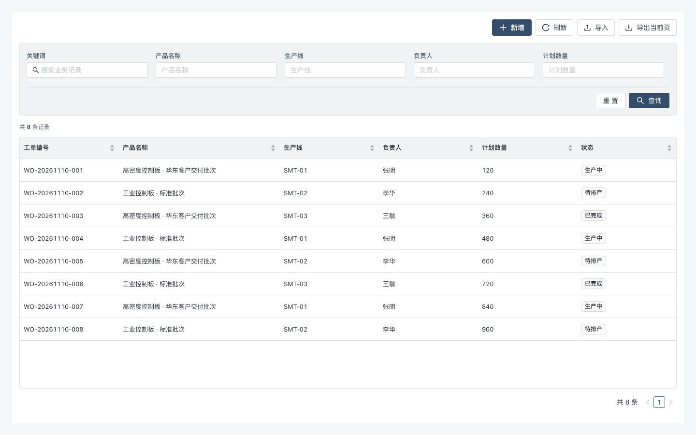

# Impeccable 接入与业务列表优化

日期：2026-11-10。沿用 0.3.21 待发布草稿，未部署。

## 接入

- 项目级技能位于 `.agents/skills/impeccable`，版本 4.8.2，来源 `pbakaus/impeccable` 的 Codex 构建。
- 使用 skill-installer 安装；这是技能安装，未安装自动 hook。
- 下次对话可使用 `$impeccable`；若未显示，重新加载工具。可输入 `$impeccable critique 业务数据列表页` 或 `$impeccable polish 具体页面`。
- 产品背景记录在 `PRODUCT.md`，现有灰蓝设计规范记录在 `DESIGN.md`。用户确认使用人群为所有人员，具体角色与权限沿用现有系统。
- 本机引擎为 0.1.22，来自官方 npm 包 `@impeccable/cli-darwin-arm64@0.1.22`。引擎 SHA-256 与技能内 `engine-checksums.txt` 一致：`afaf25d233e69580ec4566c0bbe07438ed18a67ba6ba8541fc079eadf842fa44`。GitHub Release 直连下载超时，故使用 npm 平台包。
- 引擎位于技能的 `scripts/bin/darwin-arm64/impeccable`，为本机运行文件，已加入 `.gitignore`。其他机器需要按自身平台安装引擎。

项目根目录可运行：

```bash
.agents/skills/impeccable/scripts/impeccable detect frontend/src/pages/DynamicPage
```

## 本轮范围

优化真实 `DynamicPage` 业务列表组件：独立列表的新增、刷新、导入、导出按钮显示文字；有外部标题栏的嵌入列表保留紧凑图标。筛选区使用现有主题变量，桌面按宽度排列，窄屏展示全部筛选字段并在内容区滚动。加载中说明当前状态；无记录、无匹配结果和失败分别给出提示，配置提供的自定义空状态仍优先。

未更改接口、权限、记录写入、筛选参数、排序、分页和审批规则。安装前已有的未提交改动均保留。

## 验证

- `cd frontend && npm run build` 通过；Vite 提示部分产物超过 500 kB，本轮未处理打包拆分。
- `node --test tests/formWorkspace.test.cjs tests/viewConfig.test.cjs tests/fieldProtection.test.cjs tests/previewPermissions.test.cjs`：15 项通过。
- 本地 Chrome 渲染真实组件，使用模拟 API 数据，验证 1440×900 和 390×844 视口；无页面运行异常，窄屏文档宽度为 390px。查询无结果显示恢复提示，重置后记录恢复。
- Impeccable 检测器扫描 DynamicPage 下 3 个源文件，退出码 0，无源码规则命中。该扫描只运行源码正则规则，未运行基于渲染 DOM 的字号和对比度规则，不能代表全站审计通过。
- 临时浏览器验收入口已删除；截图保留在 `docs/operations/ui/`。截图中的工单数据为模拟验收数据。
- 未执行真实后端端到端验收，未提交、推送或部署。

桌面截图：



窄屏与空状态分别见同目录的 `impeccable-business-list-mobile.png`、`impeccable-business-list-empty.png`。


[后续全站 UI 优化与验收](ui-system-2026-11-10.md)：公共主题与主要页面的后续改动、真实演示后端验证及截图。
