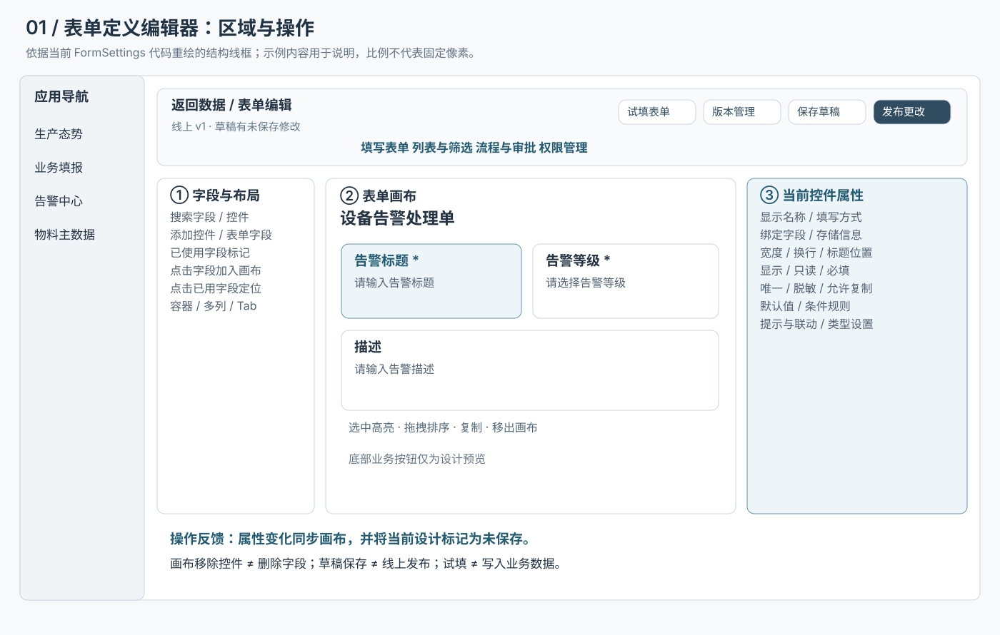
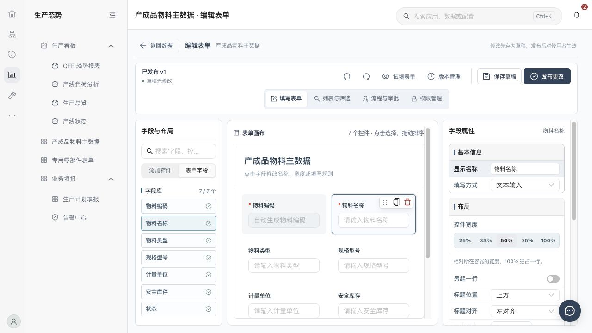
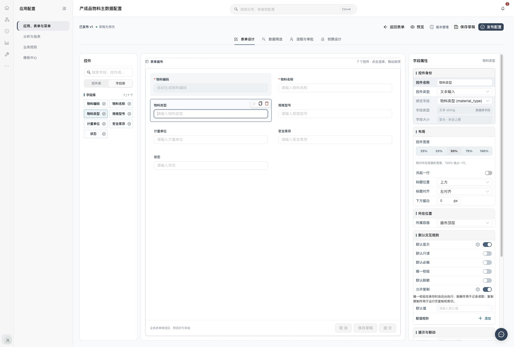
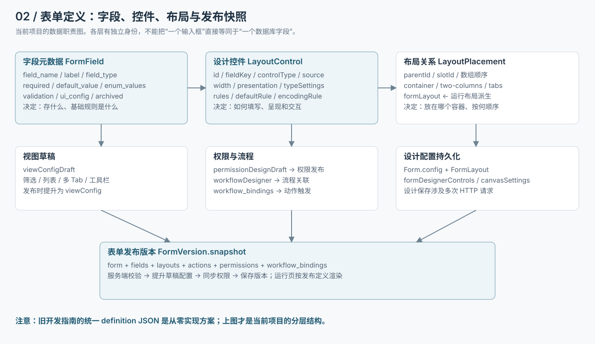
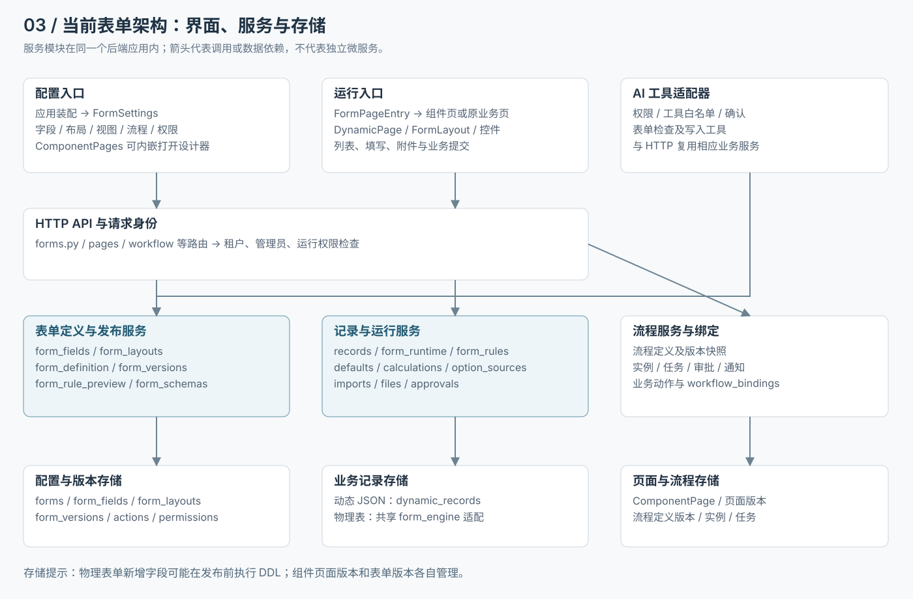
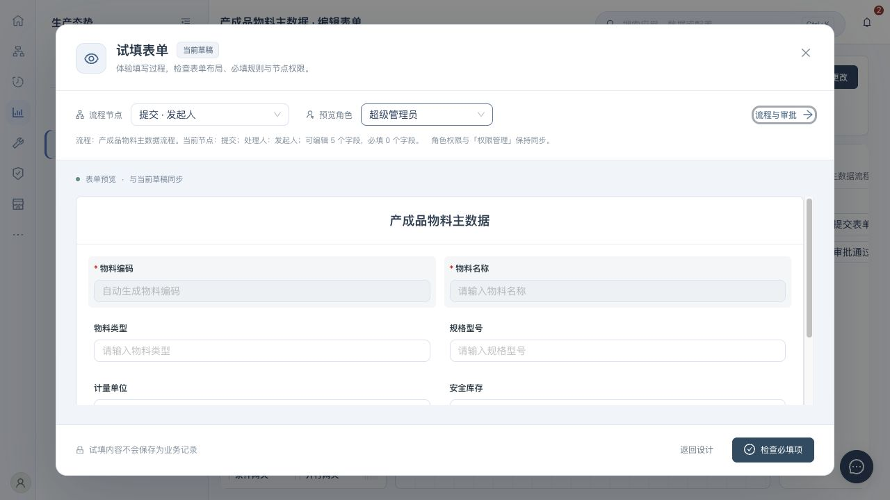
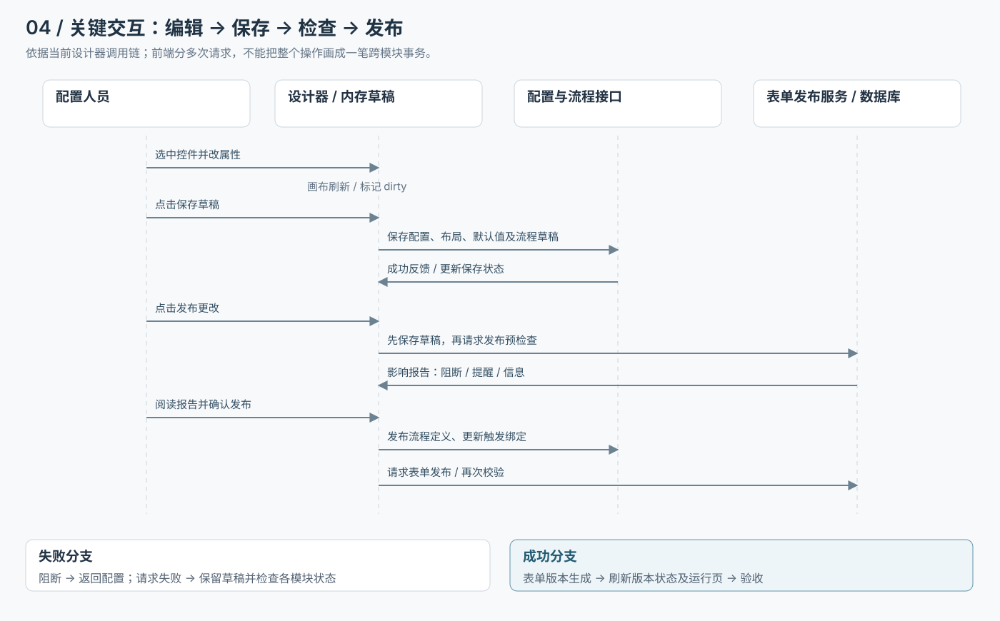
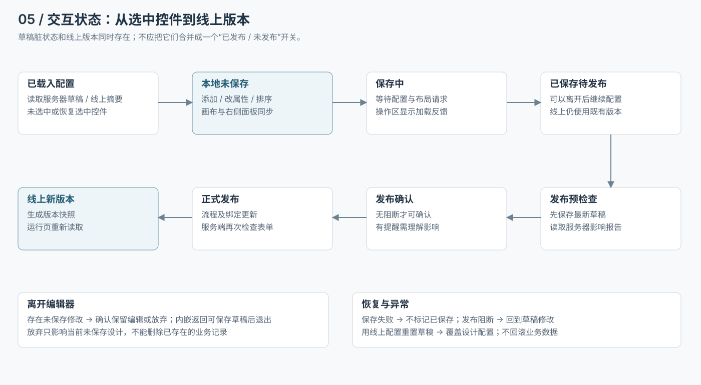
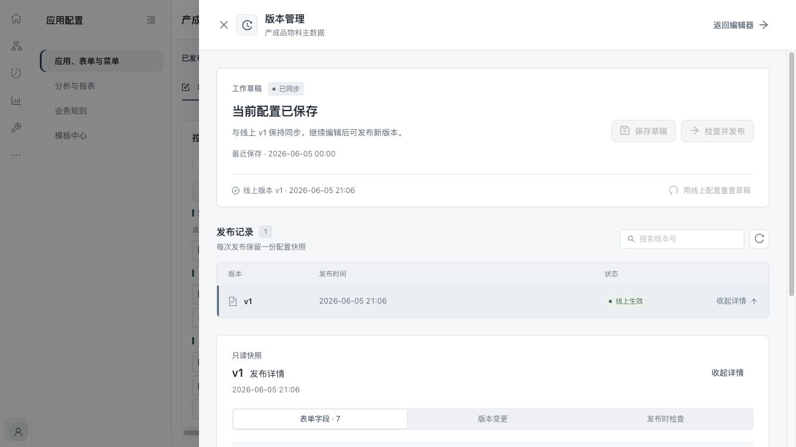
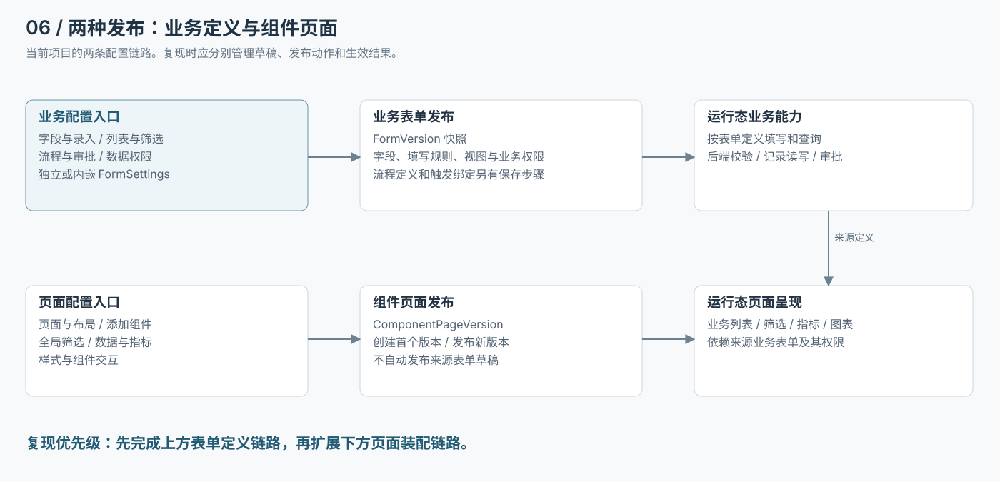

# 业务表单定义：现有 UI、架构与交互参考

更新日期：2026-10-26。本文面向从零编写表单系统的开发者，重点说明现有项目“如何让用户定义表单”，可与[从零开发规格](related/business-form-from-scratch.md)配套阅读。

## 1. 阅读范围与证据

本文的架构、数据职责及操作行为依据当前仓库代码核对；线框图是对现有结构的重绘，不是新产品方案。界面截图来自项目已有的 2026-10-23 历史设计预览文件，并已逐张查看，属于视觉参考，未经当前部署环境实测。截图内的名称、数据、日期和版本号均不能作为当前业务事实。

从零开发规格选择了简化的统一 definition 对象、乐观锁和发布事务等实现方案；当前项目存在字段元数据、Form.config、FormLayout、流程定义和页面版本等多个配置载体。阅读时不要把新系统方案直接当作当前系统的接口或数据库实现。

本目录提供六张可缩放 SVG 图、四张界面参考图、本文及可直接用浏览器打开的 index.html。图和截图都在 assets 内，整个目录可以独立转交。

## 2. 编辑器整体 UI





结构从外到内分为应用壳层、设计工具栏、配置页签和三栏工作区。应用菜单提供上下文，表单编辑器负责当前表单定义，不负责重新设置整个应用。

### 2.1 顶部工具栏

- 左侧：返回入口、当前表单身份、线上版本及草稿状态。
- 中间：填写表单、列表与筛选、流程与审批、权限管理。
- 右侧：布局撤销/重做、试填表单、版本管理、保存草稿、发布更改。

独立设计页对应名称为“表单设计”“数据筛选”“流程与审批”“权限设计”；发布按钮显示“发布配置”，预览按钮显示“预览”。这是同一设计能力的不同入口名称，不应在从零实现时误建两套业务逻辑。

撤销/重做在内嵌填写表单页签中针对布局修改提供；不能据此承诺所有权限、流程和服务端写入都能统一撤销。

### 2.2 左栏：字段与布局

左栏有搜索以及“添加控件 / 表单字段”切换。字段库表达已有字段资产，控件库表达可加入画布的交互或布局元素，两者职责不同。

点击尚未使用的字段，将字段加入填写画布；点击已使用字段，选中对应控件并在右侧配置。已使用标记帮助用户理解字段与画布的关系。

布局元素包括容器、多列和 Tab 等；它们只组织界面，不保存一个新的业务字段值。输入控件需要绑定有效存储字段。

### 2.3 中栏：填写画布

中栏显示表单标题、容器和输入控件。选中控件后高亮边界，并显示拖动、复制和移出动作。控件按所属容器、槽位和顺序呈现。

设计中的输入框主要表达布局与控件外观。需要完整填写体验时进入试填；画布底部的保存、提交等业务按钮不是正式写入入口。

### 2.4 右栏：选中对象的属性

右侧按当前对象类型展示适用属性，不固定显示所有控件的全部设置。典型分组包括基本信息、布局、所在位置、交互规则、默认值、类型设置和提示联动。

选中对象、切换控件类型、修改来源时，都要更新右侧可用项，避免把上一控件不适用的设置残留给下一控件。

## 3. 属性面板应该怎样表达“表单定义”



### 3.1 控件身份和字段身份分开

控件 id 标识画布对象；fieldKey 关联字段的 field_name。显示名称、填写方式和字段绑定是三个概念。

例如，一个控件名为“物料类型”，填写方式是“选择控件”，绑定字段为 material_type，底层仍可能是 string。将文本控件切换为选择控件时，需要检查选项和存储类型，不应自动推断为数据库字段重命名。

已有字段的业务类型可以是编码、人员、关联对象等，存储类型和业务类型并不总是相同。当前编码字段对外存储类型归一化为 string，规则由 ui_config 中的 businessType、controlType 和 encodingRule 表达。

### 3.2 布局属性

宽度相对于当前容器而非整个浏览器。当前支持 quarter、third、half、twoThird、threeQuarter、full，运行布局按 12 列换算为 3、4、6、8、9、12。

另起一行、标题位置、标题对齐、标题宽度、下方留白等由 presentation 表达。容器类型及其 layout 决定子槽位，例如多列的列槽位和 Tab 的页签槽位。

属性变化应立即同步到画布，同时进入未保存状态。显示尺寸不能只写进 DOM 或 CSS 而不持久化，否则刷新后会丢失设计。

### 3.3 默认状态与条件规则

当前规则键包括 visible、readonly、required、unique、masked、copyable、optionSort。规则具有 enabled 状态，并可以附带 conditions 或 conditionGroups 等规则信息。

右侧开关控制默认启用状态，配套设置入口用于配置条件或策略。是否显示、是否只读、是否必填分别表达不同能力，不能用一个 disabled 属性替代。

脱敏、唯一性、复制限制等需要按各自执行位置实现：例如唯一性由后端写入校验，脱敏影响读取及显示。画布上开关能切换，并不能代替服务端逻辑。

### 3.4 默认值与选择来源

固定默认值、默认值规则、计算规则、引用回填应区分。普通编辑不能因为重新渲染而覆盖用户已经输入的值。

选择来源包括静态选项、数据字典、基础档案、业务表单、用户组织和外部接口。改变来源时，应清理不再适用的映射和搜索设置，再让用户确认显示字段、值字段、过滤范围及默认值。

外部接口配置引用受管理的数据源及映射，接口地址和认证由数据连接管理；不能让表单属性面板直接保存或展示认证密钥。

## 4. 字段到画布、再到运行页的数据结构



### 4.1 当前项目有四种主要定义

- 字段元数据：field_name、label、field_type、required、default_value、enum_values、validation、ui_config，以及列表/录入/搜索标记。
- 控件定义：id、fieldKey、controlType、source、width、presentation、rules、typeSettings、defaultRule、encodingRule 等。
- 布局定义：数组顺序、parentId、slotId、容器 layout，及生成的运行态 formLayout。
- 业务视图与控制：viewConfigDraft、permissionDesignDraft、workflowDesigner 及流程触发绑定。

这些定义在发布时组成版本快照。自研可以重新组织数据库，但必须保留“字段资产与画布实例”“编辑定义与运行定义”“配置与业务记录”的区别。

### 4.2 一个控件定义的示例

下面是依据当前 LayoutControl 类型整理的示例，不是从数据库导出的完整表单。title 字段、container-basic 容器及 body 槽位需已存在；编码、选项等不适用属性已省略。

```json
{
  "id": "control-title",
  "source": "field",
  "fieldKey": "title",
  "controlType": "text",
  "name": "告警标题",
  "parentId": "container-basic",
  "slotId": "body",
  "width": "half",
  "placeholder": "请输入告警标题",
  "presentation": {
    "startNewRow": false,
    "labelPosition": "top",
    "labelAlign": "left",
    "spacingAfter": 0
  },
  "typeSettings": {"maxLength": 100},
  "rules": {
    "visible": {"enabled": true},
    "readonly": {"enabled": false},
    "required": {"enabled": true},
    "unique": {"enabled": false},
    "masked": {"enabled": false},
    "copyable": {"enabled": true},
    "optionSort": {"enabled": false}
  }
}
```

fieldKey 用于关联字段；id、parentId、slotId 用于布局。运行页提交的业务数据以 title 为键，不应把 control-title 当成业务字段名。

### 4.3 保存时如何组织配置

当前设计器将 layoutControls 保存到 Form.config.formDesignerControls，将 canvasSettings 保存到同名配置，并从控件布局生成 formLayout。

列表配置进入 viewConfigDraft，权限配置进入 permissionDesignDraft；同时通过布局接口写入 view 和 form 类型的 FormLayout。字段默认值及流程草稿也有自己的同步步骤。

因此“保存设计”是配置聚合操作，不只是保存一张画布截图，也不只是一条 JSON 写入。自研时建议先确定唯一权威来源及派生数据规则，避免多个配置副本互相覆盖。

发布时将 viewConfigDraft 提升为 viewConfig、permissionDesignDraft 提升为 permissionDesign，并同步已发布权限。快照涵盖 form、fields、layouts、actions、permissions、workflow_bindings。

### 4.4 当前实现与从零方案的区别

从零开发规格中的统一 definition、expectedRevision 和发布指针，是供新系统实施的方案；当前项目使用自身配置对象与版本查询逻辑，不能照图推断它已经具备相同的并发协议。

当前 records 服务通过 form_runtime 解析最新已发布字段。记录带 schema_version，不代表所有历史编辑都会固定使用记录创建时的字段版本；从零开发规格中“历史编辑固定绑定版本”的规则是单独选定的设计。

## 5. 当前系统架构参考



前端入口有三类：应用装配建立表单与菜单关系；FormSettings 管理业务定义；ComponentPages 组织页面组件，并可内嵌打开来源表单编辑器。

FormPageEntry 解析业务路由绑定后，进入组件页面或原业务页面。DynamicPage 结合字段、布局、视图及运行权限提供列表、填写和业务操作。

后端 HTTP 路由和 AI 工具通过相应共享服务处理字段、布局、定义、版本和业务记录。它们属于现有后端应用内的模块，不是多套独立微服务。

配置、版本、动态 JSON 记录与物理业务表分别承担不同存储职责。物理表单创建与新增字段可能执行 DDL，不能承诺保存前或发布前所有结构操作都不影响数据库。

## 6. 交互规范：每个动作改变什么

### 6.1 添加、选中和属性编辑

用户从字段库加入字段后，在画布中生成或选中对应控件；右侧读取该控件的属性。点击画布其他控件时切换选中 id；切换设计页签时清空控件选中状态。

属性修改更新当前控件，并同步画布和 dirty 状态。切换选中对象本身不应视为业务配置变更。文字输入中的复制、删除等按键应优先用于输入框，不应误操作整个控件。

### 6.2 拖动与嵌套

拖动决定顺序、parentId 和 slotId。放入容器时更新归属；插入相邻控件前后时保持正确父级及槽位。

禁止将父容器拖进自身或后代，防止形成循环。配置标准化时处理无效父级、无效槽位和重复 id，避免损坏的旧配置让页面无法加载。

图中三栏宽度仅供布局参考。实现时应保证属性面板可独立滚动，字段库可搜索，画布有清晰的选中边界和落点反馈。

### 6.3 复制与移除

复制控件或容器时，生成新的控件 id，并重建复制子树内部的父子引用。复制输入控件后仍需重新检查字段绑定；不能因为画面上出现两个输入框就允许重复写入同一字段。

移出普通控件仅移除画布实例，字段资产保留。移除布局容器时，其内部控件提升到上一级并保留，不能默认级联删除业务字段。

删除字段资产是另外的结构操作，需要检查历史数据及发布影响。UI 文案应明确使用“移出画布”，不要用模糊的“删除”混淆两个动作。

### 6.4 保存、离开和失败反馈

保存草稿显示加载反馈，成功后更新保存状态；失败时保留当前编辑内容并展示错误。存在未保存修改时，离开需要提示继续编辑或放弃；内嵌返回入口还提供保存草稿后返回的路径。

当前流程定义加载失败时会禁止保存和发布，避免用空配置覆盖已有流程。自研时也应区分“服务器没有配置”和“配置加载失败”。

不要给每次属性修改都弹确认框；在离开、重置或发布等有明确边界的动作上集中反馈。

## 7. 试填交互



试填以弹窗打开，标识“当前草稿”。顶部选择流程节点和预览角色，中间使用当前草稿的填写布局，底部提供返回设计和检查必填项。

切换节点或角色后更新可见、只读、必填等体验。没有关联流程或可用角色时显示真实缺失信息，不凭空制造已生效的权限。

试填内容不保存为业务记录。检查必填项只覆盖预览的相应校验；数值、格式、字节限制、唯一性和真实账号权限等，需要发布后在运行页验证。

## 8. 保存与发布交互链路



点击发布更改先保存当前草稿，然后请求服务端影响预检查。确认弹窗展示阻断、提醒及影响数据；存在阻断时返回修改，不能继续正式发布。

确认发布后，当前设计器会发布流程定义、更新触发绑定，再请求表单发布。服务端执行最终检查、同步权限并保存表单版本。

这条前端链路包含多次请求，不具备覆盖所有模块的一笔数据库事务。若中间失败，不能只看某个流程已经更新就提示整次表单发布成功，应保留配置并检查各模块状态。

表单发布成功后刷新版本摘要与运行页，组件页面布局是否变化则取决于它自己的发布版本。



状态区需要同时回答：线上当前是哪个版本，工作草稿是否有未保存修改，是否已保存但等待发布。一个“已发布”标签无法完整表达这三件事。

## 9. 版本管理抽屉



版本管理从右侧打开，保留编辑器上下文。顶部是工作草稿及保存/检查发布动作，中间是线上版本与发布记录，展开后查看只读快照。

详情按“表单字段”“版本变更”“发布时检查”分组。版本变更比较相邻发布快照；发布检查显示当时保存的报告，不表示今天重新检查的结果。

“用线上配置重置草稿”需要确认覆盖当前未保存或已保存未发布的设计修改。它恢复布局、视图、权限、流程关联及默认值，不回滚业务记录，也不完整重建数据库字段结构。

历史详情为只读，不应把点击历史版本解释为已经切换线上版本。

## 10. 组件页面与来源表单的关系



当前组件页面右侧设置包含页面与布局、全局筛选、添加组件、数据与指标、权限设置。组件有自己的数据、样式、交互属性。

业务配置通过“字段与录入”“列表与筛选”“流程与审批”“数据权限”打开来源表单编辑器。这些入口也可以从画布右键菜单进入。

页面布局和组件交互发布到 ComponentPageVersion；来源表单定义发布到 FormVersion。修改两者时分别保存并发布，不能让“发布页面”悄悄发布尚未确认的字段或流程草稿。

对从零复现而言，先实现表单定义、预览、发布和业务运行闭环，再增加组件页面装配。页面皮肤和图表不是表单定义功能的前置条件。

## 11. 从参考图落实为开发任务

- 建立 FieldDefinition、ControlDefinition、LayoutPlacement、ViewDefinition、PermissionDefinition 等边界，明确它们的序列化形式。
- 建立可选择控件的画布、根据选择切换的属性面板、字段库及布局库。
- 将添加、移动、复制、移出和属性修改整理为明确的状态更新操作，统一更新 dirty 与适用的历史记录。
- 实现容器与槽位关系，校验重复字段绑定、无效引用和循环嵌套。
- 用同一套字段呈现能力支撑画布、试填和运行页，同时隔离预览状态与实际业务写入。
- 实现保存、发布检查、确认发布、版本详情和草稿重置，并分别处理成功、失败、加载和冲突。
- 实现服务端字段校验及权限检查；前端开关必须有对应的运行机制。
- 分别验收“移出控件保留字段”“容器移除保留子控件”“修改草稿不切换线上定义”“试填不写记录”“表单和页面独立发布”。

## 12. 维护与验证边界

本参考核对了源码职责、操作名称和四张历史截图，完成了 SVG 与离线 HTML 的生成。它不等同于当前部署环境的端到端测试；复现时仍需按开发规格完成真实账号、数据和失败分支验收。

核对位置（仓库相对路径，供有现有源码的维护者使用；独立复现不依赖这些文件）：

- frontend/src/pages/FormSettings/index.tsx：编辑器、属性、保存、试填与发布调用链。
- frontend/src/utils/formLayout.ts：父子槽位、标准化、移动、复制、解除容器及运行布局。
- frontend/src/pages/FormSettings/VersionManager.tsx：工作草稿、版本记录和重置确认。
- frontend/src/pages/ComponentPages/Inspector.tsx 与 index.tsx：页面属性、业务入口及独立发布。
- frontend/src/pages/ComponentPages/FormPageEntry.tsx：运行路由绑定解析。
- backend/app/services/form_definition.py、form_versions.py、form_runtime.py、records.py：字段归一化、快照、发布、恢复及运行字段解析。

如果继续细化，下一步应把每个属性项的类型、默认值、可选值、适用控件、互斥条件和服务端执行点整理成逐项规格；本参考重点解决 UI 结构、架构和交互，不将截图当作完整字段字典。
